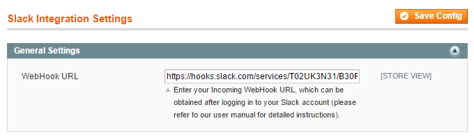
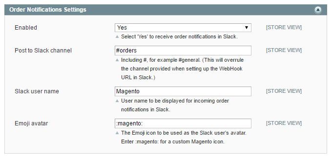

# Configuring the Slack Integration Extension

To configure the extension, navigate to **System > Configuration** in the top Admin Panel menu and select 'Slack Integration Settings' from the left side menu.

Using the extension's config screen you can configure your Slack Incoming WebHook URL and the order notification settings as further explained below.

It's possible to configure the extension per store view by changing the 'Current Configuration Scope' at the top left corner of the screen.

To save any changes made in the Slack Integration Settings, click the 'Save Config' button in the top right corner of the configuration screen.

## General Settings

In the extension's General Settings you need to enter your Incoming WebHook URL which can be obtained by logging in to your Slack account as described in [Configuring the Incoming Webhook](./05-configuring-the-incoming-webhook.md).

## Order Notification Settings

In the Order Notifications Settings you can:

- Enable order notifications to receive Magento order updates in Slack.
- Enter the Slack channel in which you'd like to receive your order notifications from Magento including the hashtag (#). The channel entered here will override the channel provided when [configuring the Incoming WebHook](./05-configuring-the-incoming-webhook.md) in Slack.
- Enter a user name for receiving Magento order notifications in Slack.
- Choose an Emoji icon to be used as the Slack user avatar. Enter :magento: to use the extension's custom Magento icon.

---

[Documentation index](./README.md) · [README](../README.md) · [Online version](https://plugin.company/knowledge-base/docs/magento-slack-integration/user-manual/configuring-the-slack-integration-extension/)
