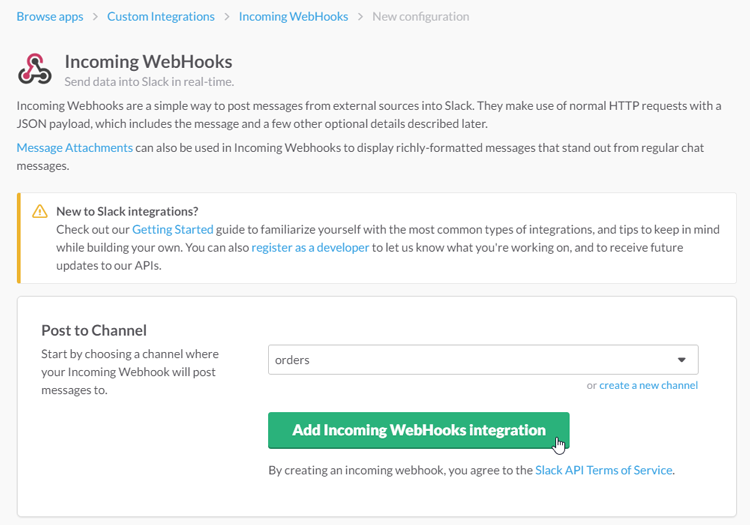

# Configuring the Incoming Webhook

After logging in to your Slack account, click your account name in the top left corner of the screen and select 'Apps & integrations' from the menu.

Search for 'Incoming WebHooks' in the App Directory.

On the Incoming WebHooks page, click the 'Add Configuration' button.

Select the channel in which you want to receive your Magento order notifications or create a new channel, then click the 'Add Incoming WebHooks integration' button.

Copy the created WebHook URL and paste it into the Slack Integration [General Settings](./04-configuring-the-slack-integration-extension.md) in the Magento Admin Panel.

---

[Documentation index](./README.md) · [README](../README.md) · [Online version](https://plugin.company/knowledge-base/docs/magento-slack-integration/user-manual/configuring-the-incoming-webhook/)
