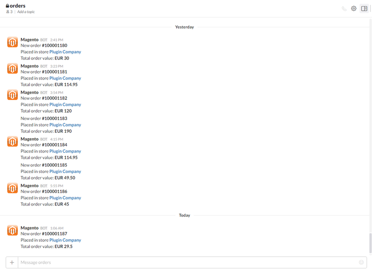

# Receiving Magento Order Notifications in Slack

After [configuring the Magento Slack Integration extension](./04-configuring-the-slack-integration-extension.md), new order notifications will be automatically posted to the Slack channel of your choice as exemplified below.

---

[Documentation index](./README.md) · [README](../README.md) · [Online version](https://plugin.company/knowledge-base/docs/magento-slack-integration/user-manual/receiving-magento-order-notifications-in-slack/)
